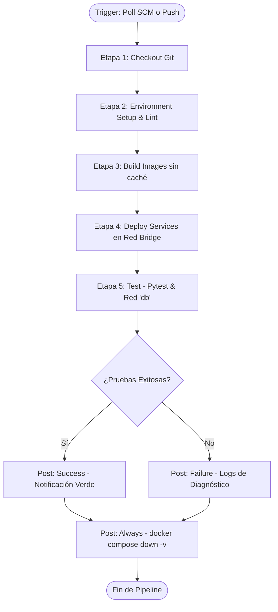

# Microservicios con Docker y Pipeline CI/CD con Jenkins
## Entregas Proyecto 1 (Escenario 3) y Proyecto 2 (Escenario 5)

[](https://github.com/ronaldo1124/docker-comunicacion-microservicios/actions/workflows/ci.yml)


> **Institución Universitaria Politécnico Grancolombiano**  
> **Facultad de Ingeniería, Diseño e Innovación**  
> **Módulo:** Integración Continua y DevOps  
> **Integrantes:**  
> - **Sebastián Salazar Urrego** (`ssalazaru@poligran.edu.co`)  
> - **Santiago Quintana Alvarado** (`squintana@poligran.edu.co`)  
> - **Ronaldo Andrés Bautista Ruiz** (`ranbautista@poligran.edu.co`) | GitHub: [@ronaldo1124](https://github.com/ronaldo1124)  
> **Escenarios:** Proyecto 1 (Escenario 3) & Proyecto 2 (Escenario 5)  

---

## 📋 Tabla de Contenidos

- [Descripción General](#-descripción-general)
- [Estructura del Repositorio](#-estructura-del-repositorio)
- [Arquitectura Global del Sistema](#-arquitectura-global-del-sistema)
- [Entrega 2: Pipeline CI/CD con Jenkins (Escenario 5)](#-entrega-2-pipeline-cicd-con-jenkins-escenario-5)
  - [Arquitectura Docker-out-of-Docker (DooD)](#arquitectura-docker-out-of-docker-dood)
  - [Despliegue del Servidor Jenkins en Contenedor](#despliegue-del-servidor-jenkins-en-contenedor)
  - [Plugins Requeridos de Jenkins](#plugins-requeridos-de-jenkins)
  - [Gestión Segura de Credenciales en Jenkins](#gestión-segura-de-credenciales-en-jenkins)
  - [Configuración del Job Pipeline y Disparador Poll SCM](#configuración-del-job-pipeline-y-disparador-poll-scm)
  - [Anatomía del Jenkinsfile Declarativo](#anatomía-del-jenkinsfile-declarativo)
  - [Suite de Pruebas Automatizadas con Pytest](#suite-de-pruebas-automatizadas-con-pytest)
- [Entrega 1: Comunicación Inter-Contenedores (Escenario 3)](#-entrega-1-comunicación-inter-contenedores-escenario-3)
  - [Detalle de los Contenedores del Negocio](#detalle-de-los-contenedores-del-negocio)
  - [Resolución DNS y Uso del Nombre 'db'](#resolución-dns-y-uso-del-nombre-db)
  - [Buenas Prácticas y Seguridad de la Aplicación](#buenas-prácticas-y-seguridad-de-la-aplicación)
  - [Demostración de Persistencia de Datos (Volumen)](#demostración-de-persistencia-de-datos-volumen)
- [Comprobación Rápida de Comunicación (Manual y Scripts)](#-comprobación-rápida-de-comunicación-manual-y-scripts)
- [Pipeline Secundario: GitHub Actions](#-pipeline-secundario-github-actions)
- [Tabla Consolidada de Comandos](#-tabla-consolidada-de-comandos)
- [Integrantes del Equipo](#-integrantes-del-equipo)

---

## 🚀 Descripción General

Este proyecto integra una solución empresarial completa de **Microservicios Contenerizados** y su ciclo de vida automatizado mediante un **Pipeline de Integración Continua (CI/CD)** implementado en **Jenkins**:

1. **Escenario 3 (Entrega 1):** Orquestación de dos microservicios (`app` en Flask y `db` en PostgreSQL 16) aislados en una red Bridge privada (`red_interna_proyecto`), demostrando la comunicación obligatoria mediante el **nombre de servicio** (`db`) y la persistencia en volúmenes Docker.
2. **Escenario 5 (Entrega 2):** Despliegue de un servidor **Jenkins Controller** contenerizado bajo el patrón **Docker-out-of-Docker (DooD)**, el cual ejecuta un pipeline declarativo (`Jenkinsfile`) con disparador automatizado (`pollSCM`), gestión de credenciales encriptadas, construcción sin caché de ambos microservicios, ejecución de suite de pruebas con `pytest` y validación de conectividad inter-contenedor.

---

## 📁 Estructura del Repositorio

```text
docker-comunicacion-microservicios/
├── .github/
│   └── workflows/
│       └── ci.yml                     # Pipeline secundario en GitHub Actions
├── app/
│   ├── src/
│   │   ├── main.py                    # API Flask, rutas REST y diagnóstico de red
│   │   └── templates/
│   │       └── index.html             # Panel web interactivo con Tailwind CSS
│   ├── tests/
│   │   ├── __init__.py                # Módulo de pruebas
│   │   └── test_app.py                # Suite de pruebas automatizadas con Pytest
│   ├── .dockerignore                  # Exclusiones de construcción de imagen
│   ├── Dockerfile                     # Imagen optimizada python:3.11-slim (no root)
│   └── requirements.txt               # Dependencias fijas (Flask, psycopg2, pytest)
├── jenkins/
│   └── Dockerfile                     # Jenkins LTS + Docker CLI + Compose Plugin
├── tests/
│   ├── __init__.py
│   └── test_app.py                    # Reenvío de suite de pruebas desde raíz
├── .env.example                       # Plantilla de variables de entorno (sin secretos)
├── .env                               # Variables locales protegidas (ignorado en Git)
├── .gitignore                         # Exclusión de archivos sensibles y temporales
├── docker-compose.jenkins.yml         # Orquestación del servidor Jenkins (DooD)
├── docker-compose.yml                 # Orquestación de app y base de datos PostgreSQL
├── Jenkinsfile                        # Pipeline CI declarativo oficial (Entrega 2)
├── pytest.ini                         # Configuración para ejecución de Pytest
└── README.md                          # Documentación integral del repositorio
```

---

## 🏗 Arquitectura Global del Sistema

```
+---------------------------------------------------------------------------------------------------+
|                                       HOST (Máquina Física / VM)                                  |
|                                                                                                   |
|  Navegador Web / Desarrollador                                                                    |
|  - Jenkins UI: http://localhost:8080                                                              |
|  - App Flask:  http://localhost:5000                                                              |
|                                                                                                   |
|  Daemon de Docker Host (/var/run/docker.sock) <-----------------------------+                     |
+-----------------------------------------------------------------------------|---------------------+
                                                                              |
     +------------------------------------------------------------------------+
     | Montaje del Socket (/var/run/docker.sock)
     v
+------------------------------------+
|  CONTENEDOR JENKINS (jenkins_server)|
|  - Imagen: jenkins/jenkins:lts     |
|  - Docker CLI + Compose Plugin     |
|  - Red: jenkins_network            |
|  - Volumen: jenkins_home_data      |
|                                    |
|  Ejecuta pipeline:                 |
|  * docker compose build            |
|  * docker compose up -d            |
|  * pytest tests/test_app.py        |
|  * curl http://localhost:5000/...  |
+-----------------+------------------+
                  |
                  | Ordena al Docker Daemon del Host crear/manejar contenedores
                  v
+---------------------------------------------------------------------------------------------------+
|                             RED DOCKER TIPO BRIDGE (red_interna_proyecto)                         |
|                                                                                                   |
|   +-------------------------------+                   +---------------------------------------+   |
|   |         CONTENEDOR 1          |                   |             CONTENEDOR 2              |   |
|   |        Servicio: 'app'        |    DNS: 'db'      |            Servicio: 'db'             |   |
|   |   (app_service: 172.28.0.3)   | ----------------> |       (db_service: 172.28.0.2)        |   |
|   |                               |   Puerto: 5432    |                                       |   |
|   |   * Python 3.11-slim          |                   |   * PostgreSQL 16-alpine              |   |
|   |   * Flask API REST & Web UI   |                   |   * Healthcheck pg_isready            |   |
|   |   * Usuario no root (appuser) | <---------------- |   * Variables de entorno              |   |
|   |   * Suite Pytest integrada    |   Lectura / Datos |                                       |   |
|   +-------------------------------+                   +-------------------+-------------------+   |
|                                                                           |                       |
+---------------------------------------------------------------------------|-----------------------+
                                                                            v
                                                                  +---------+---------+
                                                                  |  VOLUMEN DOCKER   |
                                                                  | (db_data_volumen) |
                                                                  | Persistencia /data|
                                                                  +-------------------+
```

---

## ⚙️ Entrega 2: Pipeline CI/CD con Jenkins (Escenario 5)

### Arquitectura Docker-out-of-Docker (DooD)

Para ejecutar pipelines que construyen y prueban contenedores sin incurrir en la inestabilidad de *Docker-in-Docker (DinD)*, se adopta el estándar de la industria: **Docker-out-of-Docker (DooD)**:
- El contenedor de Jenkins monta el socket del host: `/var/run/docker.sock:/var/run/docker.sock`.
- Jenkins cuenta con su propio CLI oficial de Docker (`docker-ce-cli`) y el plugin de Docker Compose instalados en su imagen personalizada (`jenkins/Dockerfile`).
- Las instrucciones de `docker compose build` o `docker compose up` emitidas por Jenkins se despachan directamente al motor Docker del host, garantizando reutilización de capas, aislamiento y rendimiento nativo.

### Despliegue del Servidor Jenkins en Contenedor

El archivo [`docker-compose.jenkins.yml`](docker-compose.jenkins.yml) orquesta la infraestructura de integración continua:

```bash
# 1. Construir la imagen personalizada e iniciar el servidor Jenkins en segundo plano
docker compose -f docker-compose.jenkins.yml up -d --build

# 2. Verificar el estado del servicio
docker compose -f docker-compose.jenkins.yml ps

# 3. Obtener la contraseña de desbloqueo de administrador inicial
docker exec jenkins_server cat /var/jenkins_home/secrets/initialAdminPassword
```

Una vez obtenida la contraseña, accede a **[http://localhost:8080](http://localhost:8080)** para completar la inicialización.

### Plugins Requeridos de Jenkins

Para la correcta ejecución del pipeline declarativo y la integración con Docker, el servidor Jenkins debe contar con los siguientes plugins instalados (desde *Administrar Jenkins* -> *Plugins*):

| Plugin | Identificador | Justificación Técnica |
|---|---|---|
| **Pipeline** | `workflow-aggregator` | Soporte nativo para pipelines declarativos basados en `Jenkinsfile`. |
| **Git Plugin** | `git` | Permite la clonación y sondeo de repositorios Git (SCM). |
| **Docker Pipeline** | `docker-workflow` | Interacción con agentes e imágenes Docker en pasos de construcción. |
| **Credentials Plugin** | `credentials` | Almacenamiento seguro y encriptado de credenciales del sistema. |
| **Credentials Binding** | `credentials-binding` | Inyección segura de secretos como variables de entorno enmascaradas. |
| **Pipeline: Stage View** | `pipeline-stage-view` | Visualización gráfica por etapas (tiempos, aprobados en verde, fallos en rojo). |

### Gestión Segura de Credenciales en Jenkins

Cumpliendo con las directrices de seguridad de la rúbrica (**cero contraseñas en código o repositorios**):
1. Ingresa a: *Administrar Jenkins* -> *Credentials* -> *System* -> *Global credentials (unrestricted)* -> *Add Credentials*.
2. Selecciona **Kind**: `Secret text`.
3. En **Secret**, ingresa la clave de la base de datos (por ejemplo: `ci_testing_pass_2026`).
4. En **ID**, ingresa exactamente: `DB_PASSWORD`.
5. En **Description**: `Contraseña segura para PostgreSQL en CI`.
6. Guarda la credencial. En el `Jenkinsfile`, la directiva `DB_PASSWORD = credentials('DB_PASSWORD')` vinculará este valor y enmascarará cualquier impresión en consola (`****`).

### Configuración del Job Pipeline y Disparador Poll SCM

1. En el panel principal de Jenkins, haz clic en **Nueva Tarea (New Item)**.
2. Ingresa el nombre `docker-microservicios-pipeline` y selecciona el tipo **Pipeline**.
3. En la sección **Disparadores de ejecuciones (Build Triggers)**:
   - Marca la casilla: **Consultar repositorio (Poll SCM)**.
   - Configura el horario cron: `H/5 * * * *` (revisa el repositorio cada 5 minutos en busca de nuevos commits).
4. En la sección **Pipeline**:
   - Definition: **Pipeline script from SCM**.
   - SCM: **Git**.
   - Repository URL: `https://github.com/ronaldo1124/docker-comunicacion-microservicios.git`
   - Branch Specifier: `*/main`
   - Script Path: `Jenkinsfile`
5. Guarda la configuración.

### Anatomía del Jenkinsfile Declarativo

El pipeline implementado en [`Jenkinsfile`](Jenkinsfile) sigue un flujo riguroso de 5 etapas principales y bloque `post`:



1. **Checkout:** Clona el repositorio e imprime el último commit, autor y descripción.
2. **Environment Setup & Lint:** Copia `.env.example` hacia `.env`, inyecta la credencial segura `DB_PASSWORD` y ejecuta `docker compose config` para validar la sintaxis.
3. **Build:** Ejecuta `docker compose build --no-cache` para garantizar una compilación fresca y reproducible de los microservicios.
4. **Deploy Services:** Levanta los contenedores en segundo plano (`docker compose up -d`), espera activamente a que el healthcheck de `db` esté en estado `healthy` (`pg_isready`), lista los contenedores e inspecciona la red `red_interna_proyecto`.
5. **Test (Unitarias + Comunicación 'db'):**
   - **Pruebas Automatizadas:** Ejecuta la suite de pruebas unitarias dentro del contenedor mediante `docker compose exec -T app pytest tests/test_app.py -v`.
   - **Verificación de Nombre de Servicio 'db':** Consulta `/api/health` y valida que `servicio_configurado == "db"`, la resolución DNS Docker y los flags de no uso de `localhost` ni IPs fijas.
   - **Pruebas de Ida y Vuelta:** Ejecuta una operación de escritura (POST `/api/items`) y comprueba la persistencia inmediata mediante una operación de lectura (GET `/api/items`).
6. **Bloque Post:**
   - `always`: Ejecuta obligatoriamente `docker compose down -v` para limpiar contenedores y volúmenes temporales, evitando fugas en el servidor.
   - `success`: Registra el mensaje de aprobación de la Entrega 2.
   - `failure`: En caso de cualquier anomalía, extrae los registros de consola completos con `docker compose logs` para facilitar la depuración.

### Suite de Pruebas Automatizadas con Pytest

Ubicada en [`app/tests/test_app.py`](app/tests/test_app.py) (y accesible desde la raíz en [`tests/test_app.py`](tests/test_app.py)):

* `test_home_route`: Comprueba la renderización HTTP 200 de la página principal.
* `test_health_check_dns_and_service_name_success`: Simula la resolución DNS y verifica que los requerimientos (`usa_nombre_servicio: true`, `no_usa_localhost: true`, `no_usa_ip_fija: true`) se cumplan estrictamente.
* `test_health_check_when_db_unreachable`: Valida que la API responda HTTP 503 degradado cuando la base de datos se encuentra fuera de línea.
* `test_create_item_validation_empty_body`: Verifica el rechazo HTTP 400 ante cuerpos vacíos.
* `test_create_item_validation_missing_fields`: Verifica el rechazo HTTP 400 ante omisión de campos requeridos.
* `test_create_item_success`: Comprueba la inserción de datos (HTTP 201) con mock de base de datos.
* `test_get_items_success`: Comprueba la consulta de registros (HTTP 200) y su serialización JSON.
* `test_get_items_db_error`: Valida el control de excepciones de conexión a base de datos (HTTP 500).
* `test_live_database_roundtrip_if_available`: Prueba de integración real que efectúa INSERT y SELECT en el contenedor `db` cuando está disponible en la red Docker.

---

## 🌐 Entrega 1: Comunicación Inter-Contenedores (Escenario 3)

### Detalle de los Contenedores del Negocio

#### Contenedor 1: Aplicación Web / API REST (`app`)
* **Imagen base:** `python:3.11-slim` (Versión oficial, etiquetado semántico fijo).
* **Seguridad:** Usuario de sistema sin privilegios (`appuser:appgroup`), ejecución no root.
* **Caché:** Copia previa de `requirements.txt` antes del código fuente.
* **Puerto expuesto:** `5000`.

#### Contenedor 2: Base de Datos Relacional (`db`)
* **Imagen base:** `postgres:16-alpine` (Oficial, ligera y segura).
* **Persistencia:** Volumen nombrado `db_data` en `/var/lib/postgresql/data`.
* **Monitoreo:** `healthcheck` con `pg_isready -U postgres_user -d proyectodb`.
* **Dependencia de arranque:** `app` especifica `depends_on: { db: { condition: service_healthy } }`.

### Resolución DNS y Uso del Nombre 'db'

El Contenedor 1 se comunica con el Contenedor 2 utilizando **únicamente** la variable `DB_HOST=db`.
1. Docker crea un servidor DNS embebido en `127.0.0.11` dentro del espacio de nombres de cada contenedor.
2. Al ejecutar peticiones a `db`, el DNS interno resuelve automáticamente a la IP privada asignada dinámicamente en la red `red_interna_proyecto` (por ejemplo, `172.28.0.2`).
3. Se prohíbe taxativamente el uso de `localhost` (apuntaría al loopback local de la app) y de direcciones IP cableadas en código (rompería la portabilidad).

### Buenas Prácticas y Seguridad de la Aplicación

1. **Desacoplamiento Absoluto de Secretos:**
   - En `docker-compose.yml` no existen contraseñas fijadas; se cargan mediante interpolación `${DB_PASSWORD}` desde `.env`.
   - En `main.py` todas las variables se leen vía `os.getenv()`.
   - Archivo `.env` estrictamente ignorado en `.gitignore`.
2. **Contexto de Construcción Aislado:**
   - `.dockerignore` previene la inclusión de temporales (`.git`, `__pycache__`, `.env`).
3. **Imágenes fijadas:**
   - Prohibido el uso de la etiqueta mutable `:latest`.

### Demostración de Persistencia de Datos (Volumen)

Para evidenciar la retención de datos tras la destrucción de los contenedores:
```bash
# 1. Crear un registro mediante la API o la interfaz web
curl -X POST http://localhost:5000/api/items \
  -H "Content-Type: application/json" \
  -d '{"titulo": "Registro Persistente", "descripcion": "Validando volumen db_data"}'

# 2. Destruir los contenedores (sin borrar volúmenes)
docker compose down

# 3. Volver a levantar el entorno
docker compose up -d

# 4. Verificar que el registro continúa existiendo
curl -s http://localhost:5000/api/items
```

---

## 🧪 Comprobación Rápida de Comunicación (Manual y Scripts)

### Desde el Navegador Web:
Ingresa a **[http://localhost:5000](http://localhost:5000)** para interactuar con la interfaz gráfica web, consultar el estado de resolución DNS en tiempo real y registrar elementos en la base de datos.

### Desde la Terminal (Pruebas de Red y Persistencia):
```bash
# 1. Verificación de Healthcheck y Resolución DNS
curl -s http://localhost:5000/api/health | jq .

# 2. Operación de Escritura (POST)
curl -s -X POST http://localhost:5000/api/items \
  -H "Content-Type: application/json" \
  -d '{"titulo": "Prueba Manual", "descripcion": "Mensaje enviado a db"}' | jq .

# 3. Operación de Lectura (GET)
curl -s http://localhost:5000/api/items | jq .
```

---

## 🤖 Pipeline Secundario: GitHub Actions

Además del pipeline primario en Jenkins, el proyecto conserva el flujo de GitHub Actions en [`.github/workflows/ci.yml`](.github/workflows/ci.yml) para validación automática en la nube en cada `push` o `pull_request`.

---

## 📑 Tabla Consolidada de Comandos

| Categoría | Acción | Comando |
| :--- | :--- | :--- |
| **Jenkins** | Construir y levantar Jenkins | `docker compose -f docker-compose.jenkins.yml up -d --build` |
| **Jenkins** | Ver estado del servidor Jenkins | `docker compose -f docker-compose.jenkins.yml ps` |
| **Jenkins** | Obtener contraseña de administrador | `docker exec jenkins_server cat /var/jenkins_home/secrets/initialAdminPassword` |
| **Jenkins** | Ver logs de Jenkins | `docker compose -f docker-compose.jenkins.yml logs -f` |
| **Jenkins** | Detener servidor Jenkins | `docker compose -f docker-compose.jenkins.yml down` |
| **Microservicios** | Construir y levantar App + DB | `docker compose up --build -d` |
| **Microservicios** | Ver estado de microservicios | `docker compose ps` |
| **Microservicios** | Ejecutar pruebas Pytest en App | `docker compose exec -T app pytest tests/test_app.py -v` |
| **Microservicios** | Inspeccionar red interna | `docker network inspect red_interna_proyecto` |
| **Microservicios** | Inspeccionar volumen de datos | `docker volume inspect db_data_volumen` |
| **Microservicios** | Detener servicios (mantener datos) | `docker compose down` |
| **Microservicios** | Reset total (destruir contenedores y datos) | `docker compose down -v` |

---

## 👨‍💻 Integrantes del Equipo

* **Sebastián Salazar Urrego** — `ssalazaru@poligran.edu.co`
* **Santiago Quintana Alvarado** — `squintana@poligran.edu.co`
* **Ronaldo Andrés Bautista Ruiz** — `ranbautista@poligran.edu.co` | GitHub: [@ronaldo1124](https://github.com/ronaldo1124)

* **Programa:** Ingeniería de Sistemas  
* **Institución:** Institución Universitaria Politécnico Grancolombiano  
* **Módulo:** Integración Continua y DevOps  
